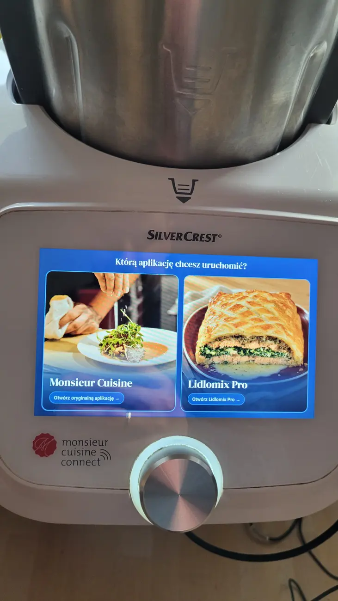

# Lidlomix Pro – Monsieur Cuisine Upgrade

Niezależny projekt rozwijający możliwości Monsieur Cuisine Connect. Zobacz zdjęcia urządzenia, katalog przepisów offline i historię projektu.

<!-- generated:readme-languages -->
**Języki / Languages**

[Polski](https://headlost.github.io/blog-lidlomix-pro/) · [English](https://headlost.github.io/blog-lidlomix-pro/en/) · [Deutsch](https://headlost.github.io/blog-lidlomix-pro/de/) · [Français](https://headlost.github.io/blog-lidlomix-pro/fr/) · [Italiano](https://headlost.github.io/blog-lidlomix-pro/it/) · [Español](https://headlost.github.io/blog-lidlomix-pro/es/)

<!-- /generated:readme-languages -->
- [Czytaj blog](https://headlost.github.io/blog-lidlomix-pro/)
- [Obejrzyj prezentację funkcji na YouTube](https://www.youtube.com/watch?v=CEdpGuIteqA)
- [Zobacz Lidlomix Pro na urządzeniu](https://headlost.github.io/blog-lidlomix-pro/dwie-aplikacje.html)
- [Dołącz do listy chętnych](https://headlost.github.io/blog-lidlomix-pro/#zapisy)

